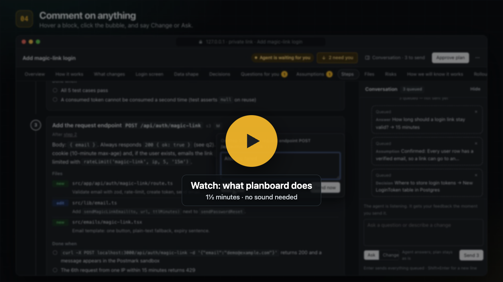

# planboard

A Claude Code skill for planning work visually before building it.

You ask Claude to plan something. It investigates, then writes the plan as a local web page: diagrams of what changes, the files it will touch, ordered steps with checks, the decisions and questions it needs from you. You review it in the browser: answer questions with a click, confirm or correct its assumptions, pick options, comment on any part. Claude gets your feedback, revises the plan, and marks what changed. When you approve, it builds the plan right there, or writes `plan.md` / `handoff.md` for later.

Everything runs on your machine. No accounts, no network, no dependencies beyond Node.

[](docs/planboard-explainer.mp4)

## Requirements

- Claude Code
- Node.js 18 or newer (`node --version`)
- macOS or Linux, and a web browser

## Install

Put this folder at `~/.claude/skills/planboard/`:

```sh
# from a zip
mkdir -p ~/.claude/skills && unzip planboard.zip -d ~/.claude/skills/
# or from a checkout, keeping it updatable
ln -s "$PWD" ~/.claude/skills/planboard
```

Check that `~/.claude/skills/planboard/SKILL.md` exists, then start a new Claude Code session. Claude Code lists `planboard` among its skills.

Optional: `node ~/.claude/skills/planboard/scripts/planboard.mjs link` installs a `planboard` command in `~/.local/bin`.

## Use

In Claude Code, either:

- type `/planboard add magic-link login`, or
- just ask: "let's plan the migration to Postgres 16", "make a plan for the offsite", "show me the plan before you start".

Claude investigates, writes the plan to `.plans/<date>-<name>/` in your project, and opens it in your browser. Then:

- **Marigold** marks what needs you. Press **N** to jump to the next one.
- Every diagram has an **Expand** button (or double-click it): full screen, zoom with − / + / Fit / 100%, drag to pan, **‹ / ›** to step between the diagrams of a section (handy for before/after), Esc or Close to go back.
- **Answer** questions, **Confirm / Wrong / Correct** assumptions, **Choose** an option on decisions.
- **Comment** on anything: hover a block (or tap it on a phone) and click the speech bubble, or select text. By keyboard: Tab to a section, arrow keys to move between its blocks, Enter to comment. Each section also has **Comment** and **Looks good** buttons in its heading. Pick **Change** (update the plan) or **Ask** (just answer me).
- Everything queues in the **Conversation** panel (press **C**) until you press **Send**. Unsent feedback survives a reload, and is also kept on the server, so it's still there in another browser.
- After Claude revises, the page reloads by itself. Teal **Δ** marks and the **Δ N changed** button (on small screens: the **⋯** menu) show what changed since you last sent feedback, and **Step through the changes** walks you through them one at a time.
- **Approve plan** when you're happy, and pick: build it here, write `plan.md`, write `handoff.md`, both, or let Claude decide.
- **⋯ → End review** closes the review; Claude goes back to the terminal.

Claude listens for your feedback in the background, so you can keep chatting with it in the terminal while the page is open; when you press **Send** it picks your feedback up right away. The top bar shows whether Claude is listening: *Agent is waiting for you* (your feedback arrives instantly), *Agent is working…* (it has your feedback), or *Agent not listening* (what you send is saved and delivered when it next checks).

## What ends up in your project

```text
.plans/2026-10-03-add-magic-link-login/
  plan.json        the structured plan (Claude edits this)
  plan.html        the visual page (Claude edits this)
  plan.md          if you asked for it (generated from plan.json)
  handoff.md       if you asked for it
  .planboard/      review state: conversation, queued feedback, last round's copy
```

Whether to commit `.plans/` is up to you. Claude asks the first time; to keep plans out of git, add `.plans/` to `.gitignore`.

A plan can be saved as one self-contained HTML file to share or archive: ask Claude to export it, or run `planboard export <dir> --html`. It opens without the server; **Send** becomes **Copy feedback** so you can paste it into a chat. By default it leaves out the review conversation and where the plan lives on your machine; add `--with-conversation` to keep them.

## Settings

Environment variables, all optional:

| Variable | Default | Effect |
| --- | --- | --- |
| `PLANBOARD_PORT` | `4517` | The server's control port (the CLI talks to it); it tries the next 39 if busy. Plan pages get their own ports from the system. |
| `PLANBOARD_HOME` | `~/.planboard` | Where the server keeps `server.json`, `sessions.json`, `plan-ports.json` (each plan's page port, reused across restarts), `server.log`, and `token` (a secret the CLI uses to talk to the server). |
| `PLANBOARD_NO_OPEN` | unset | Set to `1` to print the link instead of opening the browser. |
| `PLANBOARD_IDLE_MINUTES` | `180` | The server exits after this long with no open pages and no waiting agent. |

## Troubleshooting

In these commands `planboard` means `node ~/.claude/skills/planboard/scripts/planboard.mjs` (or the `link` shortcut).

- **What's running?** `planboard status` shows the server, its port, and every plan with whether Claude is listening.
- **Page says it can't reach the server.** The server stops after being idle. Ask Claude to open the plan again (`planboard open <dir>`), then reload the page.
- **Something looks stuck.** `planboard stop`, then `planboard open <dir>`. Nothing is lost: feedback and the conversation live in the plan's `.planboard/` folder.
- **Errors.** See `~/.planboard/server.log`.
- **Port in use.** It moves to the next free port automatically. To pick another range: `export PLANBOARD_PORT=5600`.
- **No browser opens** (Linux without a display, or over SSH). The link is printed instead. Over SSH, forward the port in that link (each plan has its own, and keeps it across restarts) and open the link on your own machine:

  ```sh
  ssh -L 55060:127.0.0.1:55060 you@server   # use the port from the printed link
  ```

- **The page says the plan moved.** The plan got a new address (its old port was taken when the server restarted). Ask Claude to run `planboard open` and use the new link; unsent feedback is kept on the server and shows up there.

- **Claude reopened a review I ended.** It shouldn't; after you end a review it needs `open --reopen`, which it only runs when you ask.
- **Diagram shows an error.** The page prints the parse error and the source; tell Claude, or point at it with a comment.

## Privacy and security

The server listens on `127.0.0.1` only and rejects requests addressed to other host names or sent from other websites. Each plan page gets its own local port, so it is its own browser origin: one plan's page can't read another plan or post feedback into it. The page's address also contains a random secret (`http://127.0.0.1:<port>/<secret>/`), so other users or programs on the machine can't read a plan or its conversation through that port; only the link planboard prints works. Review state files are readable only by you. The routes Claude uses (receiving feedback, replying, ending, stopping) also need a secret token from `~/.planboard/token`, readable only by you. It serves only files inside registered plan folders: never dotfiles, and never symlinks that point outside the folder. Plan pages run under a Content Security Policy, so they can't load scripts, styles or images from the internet, or make network requests to other sites. A page can still navigate its own tab to another website (browsers allow that), so only open plans whose plan.html you trust, the same as any web page.

## Uninstall

```sh
node ~/.claude/skills/planboard/scripts/planboard.mjs stop
rm -rf ~/.claude/skills/planboard ~/.planboard ~/.local/bin/planboard
```

Your plans in `.plans/` stay in your projects until you delete them.

## For contributors

- `SKILL.md`: the workflow Claude follows.
- `references/`: the schema, design guide, components and diagram syntax, lenses, and outputs that SKILL.md points to.
- `scripts/planboard.mjs`: CLI and local server, zero dependencies.
- `assets/shell.js`, `assets/shell.css`: the page frame injected around every plan.
- `examples/magic-link-login/`: a complete plan using every block.
